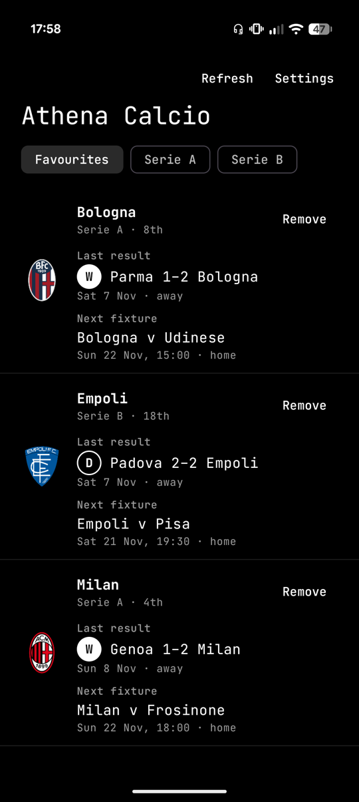

# Athena Calcio

A minimalist Android app for Italian football: current standings of Serie A and Serie B, plus favourite teams with their last result and next fixture. Serie A data from [football-data.org](https://www.football-data.org/) using your own API key; Serie B from ESPN's unofficial public feed (no key). Monochrome look shared with [Athena Launcher](https://github.com/Larmen/athena-launcher), [Athena Podcasts](https://github.com/Larmen/athena-podcasts) and [Athena Music](https://github.com/Larmen/athena-music), following the launcher's theme, typeface and text size. Android 16 and 17 only. MIT licensed.

Development is spec-driven with GitHub Spec Kit: start with [CLAUDE.md](CLAUDE.md) and `specs/001-calcio-core/`.

## Screenshots

<table>
<tr>
<td align="center"><br>Favourite teams</td>
</tr>
</table>

## Status
Spec, plan and tasks written; app built (API-key screen, standings, favourites with last/next fixture, saved copy, settings, licences) with unit tests (parsing for both sources, API errors, cache/offline logic, last/next selection, favourites, emblems, appearance). Not yet run against the real API: see `docs/manual-qa.md`.

## Build and install
```bash
export JAVA_HOME="/Applications/Android Studio.app/Contents/jbr/Contents/Home"
echo "sdk.dir=$HOME/Library/Android/sdk" > local.properties   # gitignored
./gradlew assembleDebug testDebugUnitTest lintDebug
adb install -r app/build/outputs/apk/debug/app-debug.apk
```
On first start paste your football-data.org API key; it is stored encrypted on the phone and never leaves it except as the request header to football-data.org.
